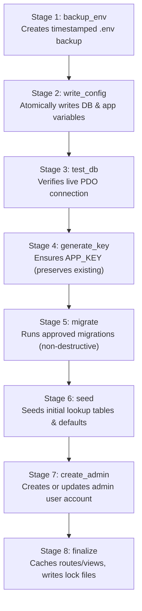

# Laravel Installation Wizard: Complete Architecture & Implementation Skill

This skill provides an authoritative, end-to-end engineering guide for building reusable, non-destructive web installation wizards for existing Laravel projects. It is engineered specifically for production environments, cPanel shared hosting, and modern SaaS distribution.

---

## Quick Reference & Table of Contents

- [Phase 1: Codebase Analysis & Pre-Flight Audit](#phase-1-codebase-analysis--pre-flight-audit)
- [Phase 2: Modular Architecture & Directory Structure](#phase-2-modular-architecture--directory-structure)
- [Phase 3: The 6-Step Installation Wizard Flow](#phase-3-the-6-step-installation-wizard-flow)
- [Phase 4: The 8-Stage Atomic Execution Pipeline](#phase-4-the-8-stage-atomic-execution-pipeline)
- [Phase 5: State Management & Multi-Location Locking](#phase-5-state-management--multi-location-locking)
- [Phase 6: Automatic Slug Redirection & Middleware](#phase-6-automatic-slug-redirection--middleware)
- [Phase 7: CLI Management Commands](#phase-7-cli-management-commands)
- [Phase 8: cPanel Shared Hosting & Apache Hardening](#phase-8-cpanel-shared-hosting--apache-hardening)
- [Phase 9: Verification & Automated Testing](#phase-9-verification--automated-testing)

### Detailed References
- [ARCHITECTURE.md](./references/ARCHITECTURE.md) — Detailed controller, service, middleware, and route patterns.
- [STAGES_PIPELINE.md](./references/STAGES_PIPELINE.md) — 8-stage automated pipeline specifications and recovery.
- [SECURITY_AND_LOCKS.md](./references/SECURITY_AND_LOCKS.md) — Lock files, Apache security, and slug redirection logic.
- [CPANEL_SHARED_HOSTING.md](./references/CPANEL_SHARED_HOSTING.md) — Shared hosting deployment guide (no-SSH, MultiPHP, cron).
- [CLI_COMMANDS.md](./references/CLI_COMMANDS.md) — `reset:install`, `installer:lock`, and `installer:status` CLI guide.

---

## Phase 1: Codebase Analysis & Pre-Flight Audit

Before writing or modifying any installer code, audit the existing target application:

1. **Framework & Runtime Inspection**:
   - Check `composer.json` for `"laravel/framework"` version constraint (`^10.0`, `^11.0`, `^12.0`, or legacy `5.6`).
   - Check minimum PHP requirement (`php: ^8.2`).
2. **User Model & Authentication Detection**:
   - Resolve User model class: check `App\Models\User` (Laravel 8+) first, fall back to `App\User` (Laravel <= 7).
   - Inspect table schema in database migrations: identify columns (`name`, `email`, `password`, `role`, `is_admin`, `email_verified_at`).
   - Check password hashing mechanism (`Hash::make()` using Bcrypt or Argon2id).
3. **Routing & Bootstrap Structure**:
   - Laravel 11/12: routes and middleware configured in `bootstrap/app.php`.
   - Laravel 5.6–10: routes in `routes/web.php` and middleware registered in `app/Http/Kernel.php`.
4. **Preservation Principle**:
   - Never overwrite existing application controllers, models, or migrations.
   - Keep installer isolated in dedicated namespaces (`App\Http\Controllers\Installer`, `App\Services\Installer`, `resources/views/installer`).

---

## Phase 2: Modular Architecture & Directory Structure

Organize the installer cleanly without polluting application core logic:

```text
app/
├── Console/Commands/
│   ├── ResetInstallCommand.php       # php artisan reset:install
│   ├── InstallerLockCommand.php      # php artisan installer:lock
│   └── InstallerStatusCommand.php     # php artisan installer:status
├── Http/
│   ├── Controllers/Installer/
│   │   ├── WelcomeController.php          # Step 1: Welcome & system overview
│   │   ├── RequirementsController.php     # Step 2: Runtime, extensions & permissions
│   │   ├── DatabaseController.php         # Step 3: DB credentials & AJAX live test
│   │   ├── ConfigurationController.php    # Step 4: App config & admin account details
│   │   └── InstallController.php          # Step 5 & 6: 8-stage execution & completion
│   └── Middleware/
│       ├── EnsureInstalled.php            # Redirects uninstalled / requests to /installer
│       └── EnsureNotInstalled.php         # Blocks /installer* when locked -> redirects to /
└── Services/Installer/
    ├── RequirementChecker.php             # Extension & filesystem permission inspector
    ├── DatabaseManager.php                # PDO connection tester & MySQL version detector
    ├── EnvironmentManager.php             # Atomic .env reader, updater, backup & key generator
    ├── AdminAccountManager.php            # Dynamic User model resolver & admin seeder
    ├── InstallationStateManager.php       # Multi-location locks & transient JSON state
    └── InstallationManager.php            # Pipeline orchestrator for the 8 installation stages
```

---

## Phase 3: The 6-Step Installation Wizard Flow

| Step | Endpoint | Purpose | Key Validations / Actions |
| :--- | :--- | :--- | :--- |
| **1. Welcome** | `/installer` | Introduction & framework telemetry | Detects PHP version, Laravel version, displays pre-flight instructions. |
| **2. Requirements** | `/installer/requirements` | Server runtime & permission checks | Verifies PHP >= 8.2, 11 required extensions, write permissions on `storage/` and `bootstrap/cache/`, writable `.env`. Live AJAX re-test. |
| **3. Database** | `/installer/database` | Database connection setup | Collects DB host, port, database name, username, password. Provides live AJAX test button via `DatabaseManager`. Encrypts credentials in session. |
| **4. Configuration** | `/installer/configuration` | App settings & Admin account | App name, URL, timezone, environment, admin name, admin email, password confirmation. Strict server-side validation. |
| **5. Installation** | `/installer/install` | Automated progress execution | AJAX-driven 8-stage runner with real-time percentage bar, animated status, and step retry capability. |
| **6. Complete** | `/installer/complete` | Verification & access handoff | Displays success card, installation completion time, database status, security status, and button to `/admin/login`. |

---

## Phase 4: The 8-Stage Atomic Execution Pipeline

To avoid PHP HTTP execution timeouts (especially on shared hosting with 30s limits), execution is decomposed into **8 discrete AJAX stages** orchestrated by `POST /installer/install/process`:



### Safety Rules:
1. **Never use destructive commands**: Never execute `migrate:fresh`, `db:wipe`, or `migrate:reset`. Only use `migrate --force`.
2. **Preserve Encryption Keys**: If `APP_KEY` already exists in `.env`, **never overwrite it**. Only generate when missing.
3. **Idempotent Stages**: If a stage fails, earlier completed stages are recorded in `storage/app/installer/installation.json` so users can resolve the error and resume without repeating non-idempotent steps.

---

## Phase 5: State Management & Multi-Location Locking

The wizard must be permanently sealed immediately upon completion to prevent unauthorized takeovers or re-installations.

### Multi-Location Lock Detection
`InstallationStateManager::isInstalled()` checks for lock files in both storage and codebase root:
- `storage/app/installer/installed.lock`
- `storage/app/installer/install.lock`
- `base_path('install.lock')`
- `base_path('installed.lock')`

```php
public function isInstalled(): bool
{
    foreach ($this->getPossibleLockFiles() as $path) {
        if (file_exists($path)) {
            return true;
        }
    }
    return false;
}
```

---

## Phase 6: Automatic Slug Redirection & Middleware

### 1. `EnsureInstalled` Middleware (Global Web Group)
- Applied to the global `web` middleware group in `Kernel.php` (or `bootstrap/app.php`).
- **When NOT Installed**: Any visitor requesting `/` (or `/download`, `/faq`, etc.) is **automatically redirected** to `route('installer.welcome')` (`/installer`).
- **Exemptions**: Routes starting with `installer`, `install`, `install-guide`, `api/v1/status`, or static assets (`css`, `js`, `images`, `favicon.ico`).

### 2. `EnsureNotInstalled` Middleware (Installer Route Group)
- Protects `routes/installer.php`.
- **When Installed / Locked**: Blocks `/installer*` access, returning HTTP 403 for AJAX or redirecting normal browser requests to the homepage (`/`).
- **Exemption**: `/installer/complete` is permitted immediately after stage 8 so the user can review their completion report.

---

## Phase 7: CLI Management Commands

Implement 3 Artisan commands to allow system administrators and automated scripts to manage the installer:

1. **`php artisan reset:install {--force} {--remove-config}`**:
   - Removes all lock files across storage and codebase root.
   - Clears `storage/app/installer/installation.json`.
   - Flushes application, view, and config caches.
   - When `--remove-config` or `--clear-env` is passed, resets database and admin credentials in `.env` while preserving `APP_KEY`.
   - Automatically causes root `/` requests to redirect back to `/installer`.
2. **`php artisan installer:lock {--force}`**:
   - Manually writes `installed.lock` and `install.lock`.
   - Instantly seals the installer and unblocks the public site.
3. **`php artisan installer:status`**:
   - Formats a detailed CLI telemetry table showing lock state, database connection, user schema, directory permissions, and PHP runtime.

---

## Phase 8: cPanel Shared Hosting & Apache Hardening

### Directory Structure for cPanel
Keep core application files above `public_html` to prevent `.env` and source code leaks:

```text
/home/username/
├── zenxtube/                     # Application Core (above public web root)
│   ├── app/
│   ├── bootstrap/
│   ├── config/
│   ├── database/
│   ├── storage/
│   ├── vendor/
│   ├── .env
│   ├── artisan
│   └── install.lock
└── public_html/                  # Web Document Root
    ├── index.php                 # Modified to require ../zenxtube/vendor/autoload.php
    ├── .htaccess                 # Apache rewrites and header hardening
    ├── assets/
    └── favicon.ico
```

### Apache `.htaccess` Protection
Prevent direct access to sensitive paths in both root and public `.htaccess`:

```apache
# Block direct access to hidden files, environment configs, vendor, and storage
<FilesMatch "^\.(env|git|lock)|composer\.(json|lock)|package\.json|artisan">
    Order allow,deny
    Deny from all
</FilesMatch>

# Prevent directory browsing
Options -Indexes
```

---

## Phase 9: Verification & Automated Testing

Always verify the installer using automated tests. To ensure compatibility across PHP 8.2+ without encountering PHPUnit 7 `$GLOBALS` reference bugs, use a standalone test runner that directly boots Laravel's HTTP Kernel:

```bash
# 1. Run automated installer test suite
php tests/test_installer.php

# 2. Check installer telemetry
php artisan installer:status

# 3. Test locking installer
php artisan installer:lock

# 4. Test unlocking and resetting installer
php artisan reset:install --force

# 5. Clear view compiler cache
php artisan view:clear
```
