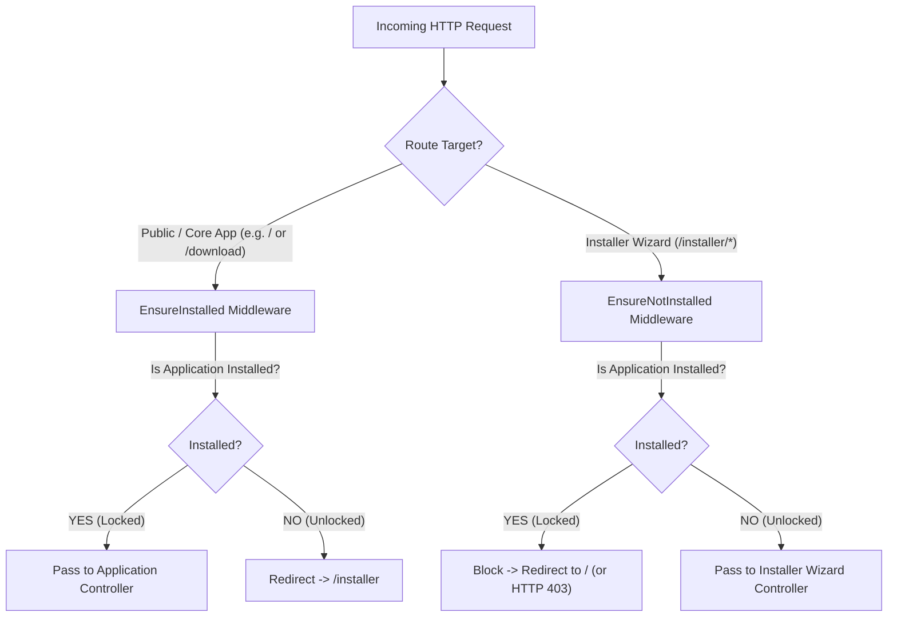

# Security, Lock Management, and Access Control

This document details the security posture, multi-location lock resolution, middleware enforcement, and Apache `.htaccess` hardening required for the installer.

---

## 1. Multi-Location Lock Architecture

Once an application is installed, direct access to the installer must be impossible to prevent unauthorized account takeover, database overwriting, or system compromise.

### Why Multi-Location Detection?
Different hosting platforms and deploy pipelines have varying filesystem characteristics:
- In some shared hosting setups, `storage/` may be cleared by automated cleanup routines or cache-clearing scripts.
- Sysadmins frequently touch a lock file at the application root (`install.lock`) during automated provisioning.
- Docker or CI/CD pipelines may mount persistent storage separately from the codebase root.

To ensure absolute security, `InstallationStateManager` implements **multi-location lock resolution**:

```php
public function getPossibleLockFiles(): array
{
    return [
        storage_path('app/installer/installed.lock'),
        storage_path('app/installer/install.lock'),
        base_path('install.lock'),
        base_path('installed.lock'),
    ];
}

public function isInstalled(): bool
{
    foreach ($this->getPossibleLockFiles() as $path) {
        if (file_exists($path)) {
            return true;
        }
    }
    return false;
}
```

### Writing the Lock
When Stage 8 (`finalize`) executes or when `php artisan installer:lock` is triggered, lock files are created with metadata:
```json
{
  "installed_at": "2026-11-09T03:20:00+00:00",
  "app_version": "1.0.0",
  "installer_version": "2.0.0",
  "locked_by": "web_wizard"
}
```

---

## 2. Middleware Enforcement & Slug Redirection

Access control is governed by two complementary middleware classes:



### `EnsureInstalled` Implementation
Registered in the global `web` middleware group:

```php
namespace App\Http\Middleware;

use Closure;
use Illuminate\Http\Request;
use App\Services\Installer\InstallationStateManager;

class EnsureInstalled
{
    protected InstallationStateManager $stateManager;

    public function __construct(InstallationStateManager $stateManager)
    {
        $this->stateManager = $stateManager;
    }

    public function handle(Request $request, Closure $next)
    {
        if ($this->shouldSkip($request)) {
            return $next($request);
        }

        if (!$this->stateManager->isInstalled()) {
            return redirect()->route('installer.welcome');
        }

        return $next($request);
    }

    protected function shouldSkip(Request $request): bool
    {
        $path = trim($request->path(), '/');

        // Allow installer endpoints, status checks, and static assets
        if ($path === 'installer' || str_starts_with($path, 'installer/')) {
            return true;
        }
        if ($path === 'install' || str_starts_with($path, 'install/')) {
            return true;
        }
        if ($path === 'install-guide' || str_starts_with($path, 'install-guide/')) {
            return true;
        }
        if (str_starts_with($path, 'api/v1/status')) {
            return true;
        }
        if (str_starts_with($path, 'assets/') || str_starts_with($path, 'css/') || str_starts_with($path, 'js/')) {
            return true;
        }

        return false;
    }
}
```

### `EnsureNotInstalled` Implementation
Protects `routes/installer.php`:

```php
namespace App\Http\Middleware;

use Closure;
use Illuminate\Http\Request;
use App\Services\Installer\InstallationStateManager;

class EnsureNotInstalled
{
    protected InstallationStateManager $stateManager;

    public function __construct(InstallationStateManager $stateManager)
    {
        $this->stateManager = $stateManager;
    }

    public function handle(Request $request, Closure $next)
    {
        // Allow the final completion screen immediately after installation
        if ($request->routeIs('installer.complete')) {
            return $next($request);
        }

        if ($this->stateManager->isInstalled()) {
            if ($request->expectsJson() || $request->ajax()) {
                return response()->json([
                    'success' => false,
                    'error' => 'Application is already installed. Installer is locked.',
                ], 403);
            }

            return redirect('/')->with('info', 'Application is already installed.');
        }

        return $next($request);
    }
}
```

---

## 3. Apache `.htaccess` Hardening

Shared hosting Apache servers must be hardened to block direct HTTP access to sensitive project files.

Add the following rules to both root `.htaccess` and `public/.htaccess`:

```apache
<IfModule mod_rewrite.c>
    RewriteEngine On

    # Block access to hidden dot files (.env, .git, etc.)
    RewriteRule ^\.(.*)$ - [F,L]

    # Block access to package managers and lock files
    RewriteRule ^(composer\.(json|lock)|package\.(json|lock)|artisan|\.lock)$ - [F,L]
    
    # Block access to installer storage logs & backups
    RewriteRule ^storage/app/installer/(.*)$ - [F,L]
</IfModule>

<FilesMatch "^(\.env|\.git|composer\.|package\.|artisan|.*\.lock)$">
    <IfModule mod_authz_core.c>
        Require all denied
    </IfModule>
    <IfModule !mod_authz_core.c>
        Order allow,deny
        Deny from all
    </IfModule>
</FilesMatch>

# Disable directory browsing
Options -Indexes
```

---

## 4. Credential & Data Sanitization Rules

1. **No Credentials in Exception Traces**:
   - When a database connection fails, catch `PDOException` and strip credentials:
     ```php
     // WRONG: return response()->json(['error' => $e->getMessage()]);
     // RIGHT:
     $cleanMessage = preg_replace('/password=[^; ]+/i', 'password=*****', $e->getMessage());
     return response()->json(['success' => false, 'error' => $cleanMessage], 422);
     ```
2. **Session Cleanup**:
   - Immediately flush database passwords and administrative passwords from session in Stage 8 (`finalize`).
3. **Debug Flag Enforcement**:
   - On completion, always set `APP_DEBUG=false` in `.env` to prevent verbose error disclosure in production.
4. **Never Provide Public Unlock API**:
   - No public HTTP route must ever exist to remove lock files or trigger `reset:install`. Lock resets must only be executable via terminal CLI (`php artisan reset:install`).
