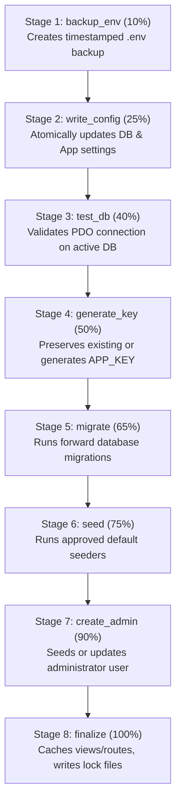

# The 8-Stage Atomic Installation Pipeline

This document details the execution order, safety contracts, error recovery, and idempotency guarantees of the automated installation pipeline.

---

## 1. Why an 8-Stage AJAX Pipeline?

Shared hosting platforms (e.g., cPanel, DirectAdmin) commonly enforce a strict `max_execution_time` of 30 seconds for web requests. Running migrations, seeding, key generation, and cache building in a single monolithic request frequently results in HTTP 504 Gateway Timeouts or incomplete database tables.

The 8-stage pipeline decomposes execution into small, independent AJAX steps orchestrated by `POST /installer/install/process`:



---

## 2. Stage Breakdown & Implementation Contracts

### Stage 1: `backup_env` (Target: 10%)
- **Action**: Copies current `.env` file to `storage/app/installer/backups/env-backup-{timestamp}`.
- **Contract**: If `.env` does not yet exist, copies `.env.example` to `.env`.
- **Failure Mode**: If storage is not writable, returns HTTP 422 with permission remediation instructions.

### Stage 2: `write_config` (Target: 25%)
- **Action**: Reads session parameters and writes to `.env`:
  - `DB_CONNECTION`, `DB_HOST`, `DB_PORT`, `DB_DATABASE`, `DB_USERNAME`, `DB_PASSWORD`.
  - `APP_NAME`, `APP_URL`, `APP_ENV`, `APP_TIMEZONE`, `APP_DEBUG=false`.
- **Contract**: Modifies only targeted keys using regex replacement. Preserves all other custom environment entries, comments, and spacing.
- **Dynamic Connection**: Immediately sets `config(['database.connections.mysql.host' => ...])` in memory so subsequent stages use the newly written credentials without requiring a new PHP worker process.

### Stage 3: `test_db` (Target: 40%)
- **Action**: Re-tests live PDO connectivity against the active database configuration.
- **Contract**: Purges any stale PDO instances via `DB::purge('mysql')` and requests a fresh connection via `DB::reconnect('mysql')`.
- **Failure Mode**: Catches `PDOException`, logs safely, and returns customer-friendly diagnostic message.

### Stage 4: `generate_key` (Target: 50%)
- **Action**: Verifies `APP_KEY`.
- **Key Rule**: **Never overwrite an existing key**.
  ```php
  $currentKey = env('APP_KEY');
  if (empty($currentKey) || $currentKey === 'SomeRandomString' || strlen($currentKey) < 16) {
      $newKey = $this->envManager->generateAppKey();
      $this->envManager->update(['APP_KEY' => $newKey]);
  }
  ```
- **Why**: Overwriting an existing key renders existing database encrypted fields (`Crypt::encryptString`) and remember-me tokens completely unrecoverable.

### Stage 5: `migrate` (Target: 65%)
- **Action**: Runs approved database migrations:
  ```php
  Artisan::call('migrate', ['--force' => true]);
  ```
- **Safety Policy**:
  - Never execute `migrate:fresh`, `migrate:reset`, or `db:wipe`.
  - Catch migration exceptions (e.g., table already exists, syntax errors) and report specific file or table name.

### Stage 6: `seed` (Target: 75%)
- **Action**: Executes initial seeders for default settings, lookup tables, or roles.
- **Contract**: Runs `DatabaseSeeder` if it exists, or specific configured seeders from `config/installer.php`.
- **Idempotency**: Seeders must use `firstOrCreate` or `updateOrCreate` to prevent duplicate primary key collisions if resumed after failure.

### Stage 7: `create_admin` (Target: 90%)
- **Action**: Creates or updates the administrator account using credentials gathered in Step 4.
- **Contract**:
  - Dynamically resolves `User` model (`App\Models\User` or `App\User`).
  - Checks available schema columns:
    ```php
    $data = [
        'name' => $admin['name'],
        'password' => Hash::make($admin['password']),
    ];
    if (Schema::hasColumn('users', 'role')) {
        $data['role'] = 'admin';
    }
    if (Schema::hasColumn('users', 'is_admin')) {
        $data['is_admin'] = 1;
    }
    if (Schema::hasColumn('users', 'email_verified_at')) {
        $data['email_verified_at'] = now();
    }
    $userModel::updateOrCreate(['email' => $admin['email']], $data);
    ```

### Stage 8: `finalize` (Target: 100%)
- **Action**:
  1. Runs safe optimization commands if running on production (`view:cache`, `route:cache`).
  2. Creates lock files across designated locations (`storage/app/installer/installed.lock` and `base_path('install.lock')`).
  3. Records final completion payload in `storage/app/installer/installation.json`.
  4. Flushes installer session data to prevent credential lingering in memory.

---

## 3. Persistent State & Resume Workflow

All progress is tracked in `storage/app/installer/installation.json`:

```json
{
  "current_stage": "migrate",
  "completed_stages": ["backup_env", "write_config", "test_db", "generate_key"],
  "last_updated": "2026-11-09T03:15:00+00:00",
  "status": "in_progress"
}
```

### Resume Capability
When an error occurs at stage 5 (`migrate`):
1. The UI reports the exact error and pauses execution.
2. The user corrects the server or database issue (e.g., grants MySQL table creation privileges).
3. The user clicks "Retry Stage".
4. The backend checks `completed_stages`. Since stages 1–4 are already marked as completed, it directly resumes at stage 5 without duplicating backups or regenerating keys.
